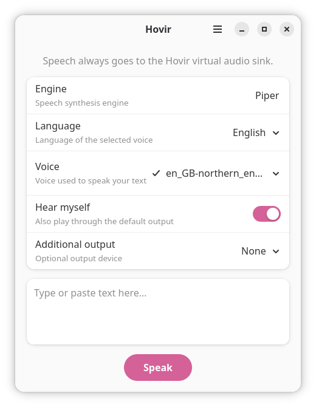
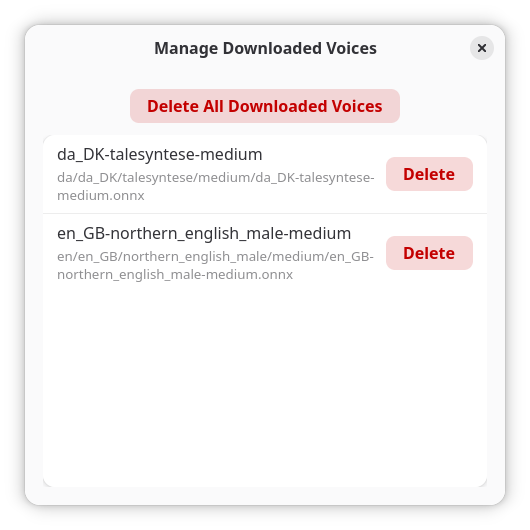

<p align="center">
  
</p>

<h1 align="center">Hovir</h1>

<p align="center">A simple desktop text-to-speech app with a virtual microphone for Linux.</p>

Hovir turns typed text into speech using Piper. Send speech to a virtual audio sink so it can be selected as a microphone in apps such as Discord, or play it through your speakers as well.

## Preview

<p align="center">
  
  
</p>

## Features

- Synthesize speech with the Piper engine.
- Browse the Piper voice catalog by language and download voices on demand.
- Use Hovir's persistent virtual audio sink as a microphone in other applications.
- Optionally hear speech on the default output and select one additional output.
- Manage downloaded voices in the app.
- Keep downloaded voice models in the Flatpak app data directory so they can be removed with Hovir's data.

Downloaded voices are stored under `~/.var/app/io.github.trunar.Hovir/data/voices/` when using the Flatpak build.

## Using Hovir as a microphone

Hovir sends speech to its **Hovir Virtual Audio Sink**. In a communication app, choose the corresponding monitor source as the microphone input. The sink remains loaded after Hovir exits so the device stays available to other apps.

Use **Hear myself** to also play speech through the default output. **Additional output** can route it to one other output device. Hovir avoids duplicate playback when that device is already the default output.

The sink can be removed from Hovir's main menu. If Hovir has already been uninstalled, it will disappear when the audio server or session restarts. See the app menu for the removal action before uninstalling.

Press **Enter** to speak. Press **Shift+Enter** to insert a newline.

## Build and run

Hovir is packaged as a Flatpak and uses the GNOME 50 runtime. Install Flatpak, Flatpak Builder, and the GNOME 50 SDK/runtime, then build and run from the project directory:

```sh
flatpak-builder --user --install --force-clean .flatpak/build-dir io.github.trunar.Hovir.json
flatpak run io.github.trunar.Hovir
```

The current development manifest installs pinned Python dependencies during the build and therefore needs network access at build time. Hovir also needs network access at runtime to refresh the voice catalog and download voices. It caches catalog metadata for offline browsing; installed voices remain available offline.

## Voices and licenses

Hovir is licensed under **GPL-3.0-or-later**; see [`COPYING`](COPYING). It uses the Piper speech engine, which is also distributed under GPL-3.0-or-later. Voice catalog metadata and files come from [`rhasspy/piper-voices`](https://huggingface.co/rhasspy/piper-voices), MIT licensed.

## Feedback

To report a problem or suggest an improvement, [open a GitHub issue](https://github.com/trunar/Hovir/issues).

## AI assistance

OpenAI Codex, using the Luna 6 model, assisted extensively with the initial application implementation, user interface, documentation, and Flatpak packaging.